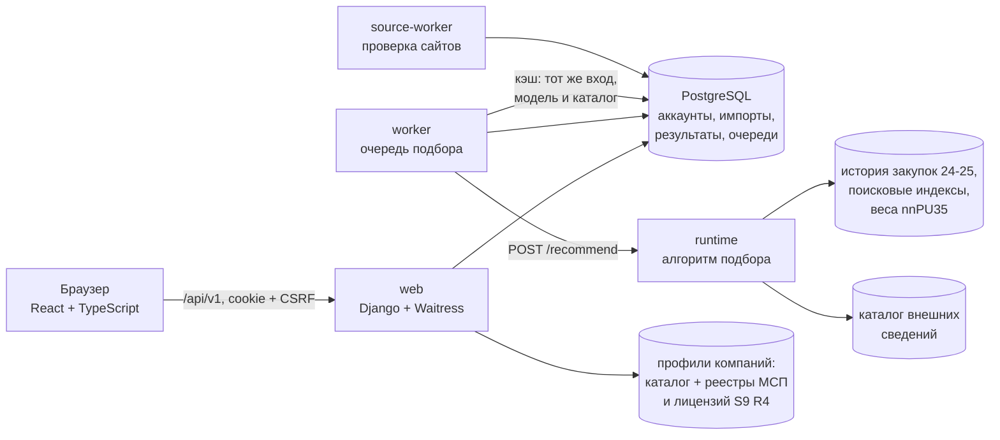

# Подбор контрагентов

Веб-приложение команды **404: Loss not found** для подбора потенциальных поставщиков по закупкам и позициям ТРУ. Специалист по закупкам загружает два CSV, проверяет распознанные данные, запускает подбор и получает для каждого лота список кандидатов с основаниями по позициям, оценкой обоснованности, источниками и подробным анализом компании. Результат можно сравнить и выгрузить в PDF, CSV или JSON.

## Архитектура



Пять сервисов Docker Compose: `db`, `runtime`, `web`, `worker`, `source-worker`. Веб-сервис слушает только `127.0.0.1`.

## Стек

| Слой | Технологии |
|---|---|
| Интерфейс | React 19, TypeScript 7, Vite 8, CSS Modules, собственный компонентный набор без UI-фреймворка |
| Backend | Python 3.13, Django 5.2, Waitress, PostgreSQL 16 |
| Алгоритм | гибридный поиск (текст, ОКПД2, технические обозначения, FTS5), признаки похожих исторических лотов, ранжировщик nnPU35, объединение рейтингов RRF |
| Данные | SQLite-индексы истории, JSON- и SQLite-каталоги профилей компаний |
| Проверки | node:test, Django test runner, unittest, Playwright |

Точные версии зависимостей закреплены в `product/frontend/package-lock.json`, `product/backend/requirements.lock` и `product/docker/runtime.requirements.lock`.

## Возможности

- **Регистрация и вход**: требования к паролю видны до отправки, ошибки показываются у полей, после истечения сессии пользователь возвращается на ту же страницу.
- **Загрузка двух CSV в любом порядке**: выбором или перетаскиванием. Тип файла определяется по колонкам, а не по имени. До отправки проверяются кодировка UTF-8, Excel и двоичные файлы, размер, дубликаты одного типа и отсутствие второго файла. Склеенный в кавычках заголовок (`"reqnum;procedure_name"`) можно исправить одной кнопкой: меняется только первая строка, данные остаются без изменений.
- **Проверка импорта**: число закупок и позиций, ошибки и предупреждения с файлом, строкой, полем и способом исправления. Предпросмотр всех позиций каждого лота без потери ведущих нулей и повторов.
- **Очередь подбора**: ход пакета, готовые лоты открываются, не дожидаясь остальных, незавершённые перезапускаются.
- **Результаты лота**: два раздельных канала («история закупок» и «внешние источники») в порядке алгоритма. Оценка обоснованности из 10 с расшифровкой при наведении, сортировка по оценке, выбор до четырёх компаний для сравнения.
- **Карточка компании**: анализ контрагента (составляющие оценки, сильные стороны, риски и пробелы, совпадение опыта с категориями закупки, участия и победы), реквизиты с источником под каждым значением, проверки перед сделкой, основания по каждой позиции с фильтрами, источники, история участия, обновление сведений с известных официальных сайтов.
- **Сравнение** по одинаковым бизнес-критериям. Ссылка содержит выбор и работает после перезагрузки. На телефоне сравнение показывается карточками.
- **Экспорт** PDF, CSV, JSON: все кандидаты или выбранные. Повтор после сбоя не создаёт лишних записей.
- **Статистика аккаунта, источники, справка**, страницы «не найдено», «нет доступа» и «сервер недоступен».

## Логика решения

1. **Импорт.** Файлы связываются по `lot_id`, идентификаторы читаются как строки. Каждая закупка сохраняется отдельным запросом с исходными строками. Лимиты: 10 МиБ на файл, 100 закупок и 10 000 позиций на импорт.
2. **Подбор.** Обработчик берёт задание из устойчивой очереди в PostgreSQL (аренда, повторы, ограничение попыток) и отправляет в runtime ровно исходные строки лота. Runtime собирает пул до 1500 кандидатов, считает признаки похожих лотов, ранжирует моделью nnPU35 и отдельно ищет кандидатов во внешнем каталоге. Ответ принимается только при совпадении SHA-256 входа, ранжировщика, версии признаков и хеша выбранной модели.
3. **Кэш повторной обработки.** Если такой же лот уже рассчитывался, а SHA-256 обоих CSV, модель, версия runtime и полный отпечаток внешнего каталога из `/info` совпадают, готовый расчёт переиспользуется без обращения к модели. Задание помечается «результат взят из предыдущего расчёта». Если изменился каталог или модель, выполняется новый расчёт. Переиспользуется только детерминированный расчёт по публичным данным; выбор, сохранение и экспорт пользователя не копируются.
4. **Оценка обоснованности (0-10)** показывает, насколько кандидат подтверждён данными. Она складывается из семи составляющих:

   | Составляющая | Макс. | Как считается |
   |---|---:|---|
   | Основания по позициям | 3 | доля позиций с основанием, противоречия вычитаются |
   | Совпадение характеристик | 1 | явные совпадения характеристик; противоречия снижают |
   | Опыт похожих закупок | 2 | объём участий (лог. шкала), участия в категориях ОКПД2 закупки, доля побед |
   | Актуальность сведений | 1 | давность последнего участия или датированного источника |
   | Реквизиты с источником | 1,5 | название, ОГРН, регион, КПП из официальных записей |
   | Сайт и контакты | 1 | подтверждённый сайт и деловые контакты |
   | Проверки юрлица | 0,5 | юридический статус, исполнение, финансы, РНП |

   Отсутствие сведений даёт 0 по составляющей, поэтому кандидат без данных оценивается ниже. Оценка не меняет порядок алгоритма, не использует его балл и не является вероятностью поставки или проверкой надёжности.
5. **Слои данных.** Неизменяемый снимок расчёта хранится отдельно от текущих сведений о компаниях. Обновление сведений не пересчитывает рекомендации. Профили компаний берутся из основного каталога. Пробелы закрываются приложением S9 R4 (`scripts/build_r4_profiles.py`): официальные записи реестра МСП ФНС на 10.12.2024 и реестров лицензий с SHA-256 точной записи, а также число участий и побед в исторических данных 24-25. Приложение читается по ИНН только для компаний конкретной выдачи.

## Запуск через Docker

Нужны Docker Engine с Compose и Python 3.12+. Для реальных рекомендаций нужен отдельный доверенный комплект ресурсов (~3,4 ГБ), описанный в `runtime-assets.json`; в репозитории его нет.

```sh
python3 scripts/package_release.py install-assets --assets-from /absolute/path/to/trusted-assets
python3 scripts/package_release.py check-assets
python3 product/docker/prepare.py
docker compose --env-file local/product-docker/compose.env up -d --build
docker compose --env-file local/product-docker/compose.env ps
```

`prepare.py` создаёт локальные пароли в `local/product-docker/secrets` и выбирает свободный порт из 8903, 8904, 8905, 8914, 8920. Адрес приложения - `http://127.0.0.1:<SUPPLY_DOCKER_PORT>/`. Готовность алгоритма: `GET /api/v1/health`, поле `engineReady: true`.

Приложение профилей S9 R4 собирается из распакованного пакета (без архива МСП):

```sh
python3 scripts/build_r4_profiles.py --r4 local/s9-r4-2026-10-02 --output local/enrichment-s9-r4-2026-10-02/supplier_profiles_r4.sqlite
```

Без этого файла приложение работает, но по части компаний название и реквизиты будут не найдены.

`web`, `worker` и `source-worker` используют сетевое пространство контейнера `runtime`, поэтому после изменений пересобирайте и запускайте их вместе (`up -d --build` без списка сервисов). Если пересоздан только один сервис, обработчики теряют сеть, и задания остаются в очереди до `up -d`.

Остановка без удаления данных:

```sh
docker compose --env-file local/product-docker/compose.env stop
```

## Локальный запуск без Docker

```sh
# 1. Алгоритм (порт 8901)
python3 -m venv .venv-runtime
.venv-runtime/bin/pip install -r product/docker/runtime.requirements.lock
PYTHONPATH=src .venv-runtime/bin/python scripts/serve_local.py --port 8901

# 2. Backend на SQLite (порт 8902) и обработчики, в отдельных терминалах
python3 -m venv .venv-backend
.venv-backend/bin/pip install -r product/backend/requirements.lock
export SUPPLY_DATA_DIR="$PWD/local/app-state"
.venv-backend/bin/python product/backend/manage.py migrate
.venv-backend/bin/python product/backend/manage.py runserver 127.0.0.1:8902
.venv-backend/bin/python product/backend/manage.py inference_worker
.venv-backend/bin/python product/backend/manage.py source_worker

# 3. Интерфейс: сборка для backend или dev-сервер с прокси /api
cd product/frontend
npm ci --ignore-scripts
npm run build                                   # backend отдаёт product/frontend/dist
API_TARGET=http://127.0.0.1:8902 npm run dev    # http://127.0.0.1:5173
```

## Входные файлы

CSV в UTF-8 (BOM допустим), разделитель `;` или `,`, порядок колонок свободный.

- Закупки: `publish_date`, `procedure_id`, `lot_id`, `start_price`, `reqnum`, `procedure_name`, `subject`, `is_smp`, `customer_inn`, `customer_kpp`, `is_eshop_or_aisgz`.
- Позиции (ТРУ): `lot_id`, `product_name`, `okpd2_code`.

## API

Базовый путь `/api/v1`. Сессионные cookie; изменяющие запросы требуют CSRF. POST создания закупки, импорта и экспорта требуют `Idempotency-Key`.

| Методы | Путь | Назначение |
| --- | --- | --- |
| GET | `/health`, `/config` | Готовность и лимиты |
| GET | `/auth/csrf`, `/auth/me` | CSRF и текущий аккаунт |
| POST | `/auth/register`, `/auth/login`, `/auth/logout` | Сессия |
| PATCH | `/auth/profile` | Имя аккаунта |
| POST | `/auth/password` | Смена пароля |
| GET, POST | `/queries` | Личные запросы (краткий список), создание закупки |
| GET | `/queries/{id}` | Сохранённый результат с профилями компаний |
| POST | `/queries/{id}/start` | Постановка подбора в очередь |
| PATCH | `/queries/{id}/saved` | Сохранение в избранном |
| POST | `/imports` | Загрузка пары CSV |
| GET | `/imports/{id}` | Результат проверки файлов |
| POST | `/imports/{id}/start` | Подбор для всего импорта |
| GET | `/companies`, `/companies/{id}` | Компании из собственных результатов; `queryId` задаёт контекст |
| GET, POST | `/source-jobs` | Состояние и запуск проверки известных официальных сайтов |
| GET | `/analytics` | Статистика аккаунта |
| POST | `/exports`, `/exports/confirm` | Формирование и подтверждение экспорта |

## Результаты и метрики

**Качество ранжирования** (validation, 220 запросов с наблюдаемыми участниками; выбор модели зафиксирован до расчёта, парный bootstrap 10 000 повторов):

| Модель | NDCG@10 | MRR | Macro Recall@10 |
|---|---:|---:|---:|
| Взвешенная формула (baseline) | 0,261 | 0,253 | 0,391 |
| nnPU34 (предыдущая) | 0,304 | 0,300 | 0,446 |
| **nnPU35 (в продукте)** | **0,329** | **0,327** | **0,458** |

Прирост nnPU35 к nnPU34: +0,025 NDCG@10, 95% ДИ [+0,007; +0,043]. Recall пула кандидатов: 0,831 (macro). Метрика восстанавливает наблюдаемых участников исторических лотов; пригодность на новых закупках без экспертной разметки не измерена.

**Скорость на сайте** (Docker на macOS ARM64, загрузка через интерфейс, время от запуска подбора до готовности последнего лота по меткам заданий):

| Набор | Лотов | Позиций | Первый расчёт | Повторная загрузка (кэш) |
|---|---:|---:|---:|---:|
| Тестовые данные 1140 | 38 | 670 | 30,5 с | 3,1 с |
| Финал 1700, файл 1 | 23 | 380 | 14,9 с | 2,1 с |
| Финал 1700, файл 2 | 24 | 155 | 16,6 с | 2,2 с |
| Финал 1700, файл 3 | 27 | 565 | 20,0 с | 3,9 с |
| Финал 1700, файл 4 | 25 | 368 | 25,2 с | 4,9 с |

Первый готовый лот появляется через 3-9 с. Загрузка и проверка пары файлов занимает менее 1 с. В первом проходе часть лотов «Финал 1700» уже пришла из кэша: они совпадают с лотами набора 1140.

**Данные профилей S9 R4**: 44 696 профилей, из них 27 570 с официальной идентификацией по реестру МСП и 2 051 с записями реестров лицензий. Число участий и побед доступно для 44 196 ИНН.

## Проверки

```sh
cd product/frontend && npm ci --ignore-scripts && npm run build && npm test && cd ../..
python3 -m venv .venv-backend && .venv-backend/bin/pip install -r product/backend/requirements.lock
SUPPLY_DATA_DIR="$PWD/local/test-backend" .venv-backend/bin/python product/backend/manage.py test api --noinput
PYTHONPATH=src .venv-runtime/bin/python -m unittest discover -s tests
```

Тесты конкурентной обработки очередей и квот рассчитаны на PostgreSQL. На SQLite они могут завершаться ошибкой блокировки таблицы. Для полного прогона положите в `SUPPLY_DATA_DIR` файл `database.json` (права 0600) с параметрами тестового PostgreSQL.

## Ограничения

- Место в списке - порядок рекомендаций алгоритма, а оценка из 10 - мера подтверждённости данными. Ни то, ни другое не является вероятностью сделки или финансовой надёжностью.
- Участие и победа в закупке не означают исполненный договор. Юридический статус, исполнение, финансы и РНП без прямого источника остаются «не проверено».
- Реестр МСП - историческая идентификация на 10.12.2024. ОКВЭД и лицензия описывают заявленную или разрешённую деятельность, а не ассортимент.
- Проверка сведений обращается только к известным официальным сайтам. Поиск всех новых компаний в интернете не реализован. Дата получения страницы не равна дате её содержания; окно 36 месяцев - ориентир, а не фильтр.

Лицензии включённых сторонних компонентов указаны в `THIRD_PARTY_NOTICES` и `product/backend/fonts/LICENSE_LIBERATION`.
